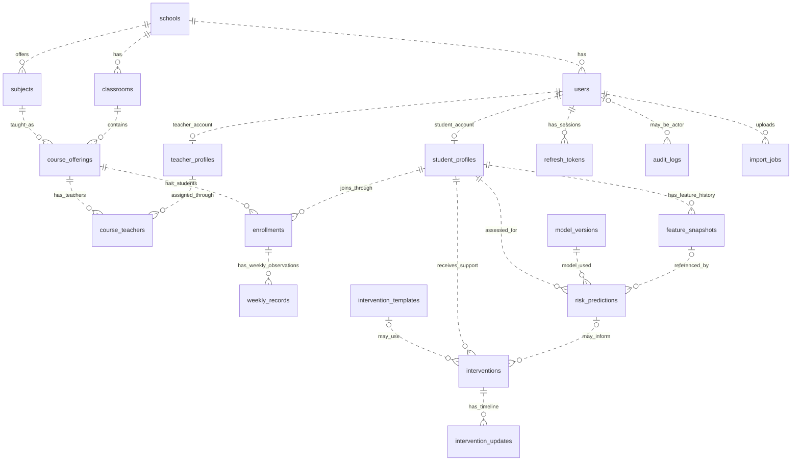

# EduGuard backend ER diagrams

Based on the SQLAlchemy models in `backend/app/models`, with nine migration files in `backend/alembic/versions`. This describes the repository schema, not an inspection of a running database.

## Reading the diagram

- PK: primary key. FK: foreign key. UK: a unique single-column value.
- `||`: exactly one. `o|` or `|o`: zero or one. `o{`: zero or many.
- Lines connect parent rows with referencing rows. Refer to the explicit key declarations for composite keys.
- A course offering means a subject taught to a classroom for an academic year.
- The overview shows selected relationships. The complete diagram includes every declared foreign key and every column.

## Presentation overview

## Important schema details

- School-scoped tables carry `school_id`. Composite foreign keys combine it with the related record identifiers. The overview omits repeated school links to stay readable.
- `course_teachers` joins teachers to course offerings. Its primary key is `(course_offering_id, teacher_id)`.
- `enrollments` joins students to course offerings. A student/course pair is unique.
- `weekly_records` links to an enrollment through `(school_id, student_id, course_offering_id)`. There is no `enrollment_id` column. Only one record per student, course and week is allowed.
- `feature_snapshots.features` stores a JSONB feature payload. There is no separate table for each of the 40 features.
- Feature extraction reads weekly records in application code. There is no direct foreign key from `feature_snapshots` to `weekly_records`.
- Predictions reference the model version and a feature snapshot. Their composite snapshot foreign key also includes the student and course. The course can be null, so PostgreSQL's default MATCH SIMPLE behaviour means this constraint does not enforce the snapshot link in that case. The overview marks this relationship optional at the database-constraint level even though `feature_snapshot_id` itself is required.
- An intervention can optionally reference a prediction and/or template. An intervention has many timeline updates. Goals are stored in `goal_definition` JSONB, not in a separate goals table.
- `model_versions` is global. `intervention_templates.school_id` can be null for shared templates. The intervention-to-template foreign key uses `template_id` alone, so template access also depends on application checks.
- `users.role` distinguishes admin, teacher and student accounts. There is no separate admin table.
- Authentication sessions, audit history and CSV imports live in `refresh_tokens`, `audit_logs` and `import_jobs`.

## Complete physical ER diagram

The following contains all 19 tables and their columns. Repeated school and author links make this view more suitable for documentation than a single presentation slide.

```mermaid
erDiagram
    direction TB
    schools {
        uuid id PK
        varchar_200 name
        varchar_100 slug UK
        varchar_253 domain "nullable"
        boolean is_active
        timestamp_with_time_zone created_at
        timestamp_with_time_zone updated_at
    }
    users {
        uuid id PK
        uuid school_id FK
        citext email
        varchar_255 password_hash
        varchar_12 role
        varchar_100 first_name
        varchar_100 last_name
        boolean is_active
        timestamp_with_time_zone last_login_at "nullable"
        timestamp_with_time_zone created_at
        timestamp_with_time_zone updated_at
    }
    teacher_profiles {
        uuid id PK
        uuid school_id FK
        uuid user_id FK,UK
        varchar_100 employee_code "nullable"
        varchar_40 phone "nullable"
        timestamp_with_time_zone created_at
        timestamp_with_time_zone updated_at
    }
    student_profiles {
        uuid id PK
        uuid school_id FK
        uuid user_id FK,UK
        varchar_100 roll_number
        varchar_50 grade_label
        varchar_40 phone "nullable"
        text address "nullable"
        varchar_200 guardian_name "nullable"
        varchar_200 guardian_contact "nullable"
        timestamp_with_time_zone created_at
        timestamp_with_time_zone updated_at
    }
    classrooms {
        uuid id PK
        uuid school_id FK
        varchar_100 name
        varchar_50 grade_label
        varchar_30 academic_year
        boolean is_active
        timestamp_with_time_zone created_at
        timestamp_with_time_zone updated_at
    }
    subjects {
        uuid id PK
        uuid school_id FK
        varchar_40 code
        varchar_100 name
        timestamp_with_time_zone created_at
        timestamp_with_time_zone updated_at
    }
    course_offerings {
        uuid id PK
        uuid school_id FK
        uuid classroom_id FK
        uuid subject_id FK
        varchar_30 academic_year
        boolean is_active
        timestamp_with_time_zone created_at
        timestamp_with_time_zone updated_at
    }
    course_teachers {
        uuid school_id FK
        uuid course_offering_id PK,FK
        uuid teacher_id PK,FK
        boolean is_primary
        timestamp_with_time_zone created_at
    }
    enrollments {
        uuid id PK
        uuid school_id FK
        uuid student_id FK
        uuid course_offering_id FK
        varchar_9 status
        date enrolled_at
        timestamp_with_time_zone created_at
        timestamp_with_time_zone updated_at
    }
    weekly_records {
        uuid id PK
        uuid school_id FK
        uuid student_id FK
        uuid course_offering_id FK
        date week_start
        integer classes_held "nullable"
        integer classes_attended "nullable"
        numeric_14_4 study_hours_weekly "nullable"
        numeric_14_4 assessment_avg_score "nullable"
        integer assessment_count "nullable"
        integer assignment_count "nullable"
        integer assignments_completed "nullable"
        integer late_submissions "nullable"
        integer last_minute_submissions "nullable"
        numeric_14_4 avg_submission_delay_days "nullable"
        numeric_14_4 assignment_avg_score "nullable"
        integer quiz_count "nullable"
        integer quiz_attempt_count "nullable"
        numeric_14_4 quiz_avg_score "nullable"
        integer lms_login_count "nullable"
        integer lms_active_days "nullable"
        numeric_14_4 avg_lms_session_min "nullable"
        numeric_14_4 total_lms_time_min "nullable"
        integer days_since_last_login "nullable"
        integer participation_count "nullable"
        integer participation_opportunities "nullable"
        integer student_confidence_score "nullable"
        text student_checkin_text "nullable"
        varchar_20 source
        uuid created_by FK
        timestamp_with_time_zone created_at
        timestamp_with_time_zone updated_at
    }
    feature_snapshots {
        uuid id PK
        uuid school_id FK
        uuid student_id FK
        uuid course_offering_id FK "nullable"
        date as_of_date
        varchar_100 feature_version
        jsonb features
        timestamp_with_time_zone created_at
    }
    model_versions {
        uuid id PK
        varchar_200 name
        varchar_100 version
        varchar_500 artifact_path
        varchar_64 artifact_sha256
        varchar_100 feature_version
        jsonb metrics
        jsonb thresholds
        boolean is_active
        timestamp_with_time_zone trained_at "nullable"
        timestamp_with_time_zone created_at
    }
    risk_predictions {
        uuid id PK
        uuid school_id FK
        uuid student_id FK
        uuid course_offering_id FK "nullable"
        uuid feature_snapshot_id FK
        uuid model_version_id FK
        numeric_12_10 risk_probability
        varchar_20 risk_level
        boolean at_risk
        jsonb explanations
        jsonb recommendations
        uuid created_by FK "nullable"
        timestamp_with_time_zone created_at
    }
    intervention_templates {
        uuid id PK
        uuid school_id FK "nullable"
        varchar_200 name
        text description
        jsonb tags
        integer default_duration_days "nullable"
        boolean is_active
        timestamp_with_time_zone created_at
        timestamp_with_time_zone updated_at
    }
    interventions {
        uuid id PK
        uuid school_id FK
        uuid student_id FK
        uuid course_offering_id FK
        uuid template_id FK "nullable"
        uuid prediction_id FK "nullable"
        varchar_200 title
        varchar_200 frequency "nullable"
        varchar_9 status
        date start_date
        date review_date "nullable"
        timestamp_with_time_zone completed_at "nullable"
        boolean visibility_to_student
        jsonb goal_definition
        uuid created_by FK
        timestamp_with_time_zone created_at
        timestamp_with_time_zone updated_at
    }
    intervention_updates {
        uuid id PK
        uuid school_id FK
        uuid intervention_id FK
        uuid author_user_id FK
        integer sequence
        varchar_13 kind
        text note "nullable"
        jsonb details
        timestamp_with_time_zone created_at
    }
    refresh_tokens {
        uuid id PK
        uuid school_id FK
        uuid user_id FK
        varchar_64 token_hash UK
        timestamp_with_time_zone expires_at
        timestamp_with_time_zone revoked_at "nullable"
        timestamp_with_time_zone created_at
    }
    audit_logs {
        uuid id PK
        uuid school_id FK
        uuid actor_user_id FK "nullable"
        varchar_100 action
        varchar_100 entity_type
        uuid entity_id "nullable"
        jsonb metadata
        timestamp_with_time_zone created_at
    }
    import_jobs {
        uuid id PK
        uuid school_id FK
        uuid uploaded_by FK
        varchar_200 filename
        varchar_30 import_type
        varchar_30 status
        integer rows_total
        integer rows_succeeded
        integer rows_failed
        jsonb errors
        timestamp_with_time_zone created_at
        timestamp_with_time_zone completed_at "nullable"
    }
    schools ||..o{ users : "school_id"
    schools ||..o{ teacher_profiles : "school_id"
    users ||..o| teacher_profiles : "school_id, user_id"
    schools ||..o{ student_profiles : "school_id"
    users ||..o| student_profiles : "school_id, user_id"
    schools ||..o{ classrooms : "school_id"
    schools ||..o{ subjects : "school_id"
    schools ||..o{ course_offerings : "school_id"
    classrooms ||..o{ course_offerings : "school_id, classroom_id"
    subjects ||..o{ course_offerings : "school_id, subject_id"
    schools ||..o{ course_teachers : "school_id"
    course_offerings ||..o{ course_teachers : "school_id, course_offering_id"
    teacher_profiles ||..o{ course_teachers : "school_id, teacher_id"
    schools ||..o{ enrollments : "school_id"
    course_offerings ||..o{ enrollments : "school_id, course_offering_id"
    student_profiles ||..o{ enrollments : "school_id, student_id"
    schools ||..o{ weekly_records : "school_id"
    users ||..o{ weekly_records : "school_id, created_by"
    enrollments ||..o{ weekly_records : "school_id, student_id, course_offering_id"
    schools ||..o{ feature_snapshots : "school_id"
    course_offerings |o..o{ feature_snapshots : "school_id, course_offering_id"
    student_profiles ||..o{ feature_snapshots : "school_id, student_id"
    model_versions ||..o{ risk_predictions : "model_version_id"
    schools ||..o{ risk_predictions : "school_id"
    course_offerings |o..o{ risk_predictions : "school_id, course_offering_id"
    users |o..o{ risk_predictions : "school_id, created_by"
    feature_snapshots |o..o{ risk_predictions : "school_id, feature_snapshot_id, student_id, course_offering_id"
    student_profiles ||..o{ risk_predictions : "school_id, student_id"
    schools |o..o{ intervention_templates : "school_id"
    schools ||..o{ interventions : "school_id"
    course_offerings ||..o{ interventions : "school_id, course_offering_id"
    users ||..o{ interventions : "school_id, created_by"
    risk_predictions |o..o{ interventions : "school_id, prediction_id, student_id, course_offering_id"
    student_profiles ||..o{ interventions : "school_id, student_id"
    intervention_templates |o..o{ interventions : "template_id"
    schools ||..o{ intervention_updates : "school_id"
    users ||..o{ intervention_updates : "school_id, author_user_id"
    interventions ||..o{ intervention_updates : "school_id, intervention_id"
    schools ||..o{ refresh_tokens : "school_id"
    users ||..o{ refresh_tokens : "school_id, user_id"
    schools ||..o{ audit_logs : "school_id"
    users |o..o{ audit_logs : "school_id, actor_user_id"
    schools ||..o{ import_jobs : "school_id"
    users ||..o{ import_jobs : "school_id, uploaded_by"
```

## Composite uniqueness

- `users`: `(school_id, email)`; `(school_id, id)`.
- `teacher_profiles`: `(school_id, id)`.
- `student_profiles`: `(school_id, id)`; `(school_id, roll_number)`.
- `classrooms`: `(school_id, id)`.
- `subjects`: `(school_id, code)`; `(school_id, id)`.
- `course_offerings`: `(school_id, id)`.
- `enrollments`: `(school_id, student_id, course_offering_id)`; `(student_id, course_offering_id)`.
- `weekly_records`: `(student_id, course_offering_id, week_start)`.
- `feature_snapshots`: `(school_id, id, student_id, course_offering_id)`.
- `model_versions`: `(name, version)`.
- `risk_predictions`: `(school_id, id, student_id, course_offering_id)`.
- `intervention_templates`: `(school_id, name)`.
- `interventions`: `(school_id, id)`.
- `intervention_updates`: `(intervention_id, sequence)`.

Partial unique indexes additionally allow at most one active model version and require global intervention-template names to be unique.

## Simple explanation for the panel

Each school has user accounts, classrooms and subjects. Teachers and students connect to specific courses through assignment and enrollment records. Weekly observations record how an enrolled student is doing. The system builds feature snapshots and stores predictions with the model version used. Teachers can record support actions and track their progress through intervention updates.
